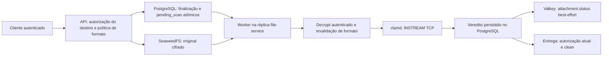

# ClamAV: diagnóstico e decomposição da #1129

Entrega A, em 2026-11-04. **Fase parcialmente concluída: baseline operacional
pendente.** Este documento não encerra a [#1129](https://github.com/nicrepository/nchat/issues/1129).
Branch `security/files-1129-clamav-baseline`, base `develop`, commit
`57d8a16dbe2e065bba958f6351f0d0d92b20dac7`. Working tree inicialmente limpo;
`git fetch origin develop` confirmou HEAD = origin/develop = merge-base.

## Fontes e limites

Foram consultados CONTRIBUTING, README, SECURITY, o prompt mestre v4 encontrado
fora do repositório, RF-22/RF-30–34 do documento de requisitos (cabeçalho v5.0,
embora o arquivo local se chame `requisitos_v5-1.pdf`),
[contrato de anexos](../api/file-attachments.md),
[política empresarial](enterprise-attachment-policy.md), migrations, testes e
manifests abaixo. O default sugerido de 50 MB dos requisitos históricos já foi
substituído pela política administrativa da #458; esta entrega não o altera.

GitHub consultado em modo leitura: #1129 aberta, sem comentários; busca de
issues com `1129 in:body` e PRs com `1129` não encontrou entregas vinculadas.
Relacionadas: #481/#117 (scan/gate), #483 (infra), #1128 (fechada; PR #1141
integrada), #1100 (integridade do composer), #948 (aberta, coexistência N/N+1).
PRs #479/#484 são antecedentes. As entregas abaixo são propostas locais, não
subissues criadas ou atribuições pessoais confirmadas. Repetir a busca antes de
abrir qualquer uma.

`kubectl config get-contexts -o name` retornou lista vazia. Não houve conexão
com Kubernetes, PostgreSQL operacional ou Prometheus. Não há observação de
réplicas, imagens em execução, assinaturas ativas, drift, saturação, backlog,
latência ou eficácia do engine nesta sessão. Números históricos nos comentários
de manifests não constituem medições deste baseline.

## Arquitetura observada e Design Review

Responsabilidades preservadas: handlers transportam contratos; service decide
inspeção/transição; storage faz claim e persistência; scanner implementa o
protocolo; worker agenda; manifests isolam o daemon; chat-service autoriza o
realtime. A coleta não executa regras de domínio, não toma leases e não publica
eventos. SRP/Separation of Concerns: SQL agrega diagnóstico; runbook coordena
ferramentas existentes; testes exercitam somente o instrumento.

Alternativas: adicionar histogramas ao worker agora, criar um coletor genérico,
ou reutilizar ferramentas existentes com SQL limitado. Escolhida a última:
menor superfície, nenhuma mudança no caminho de aprovação, schema ou contrato
N/N+1. Trade-off: não resolve a ausência de timestamps e não obtém percentis
por etapa. Histogramas completos pertencem a D, com pontos definidos abaixo.

### Código confirmado

| Componente                                                | Comportamento e implicação                                                                                                                                                                                                                                                                                                                                                                                                                                         |
| --------------------------------------------------------- | ------------------------------------------------------------------------------------------------------------------------------------------------------------------------------------------------------------------------------------------------------------------------------------------------------------------------------------------------------------------------------------------------------------------------------------------------------------------ |
| `worker/preview_worker.go`                                | Ticker de 10 s; nenhum passe imediato na inicialização; um `ProcessDue` serial por tick. Não há drain nem wake-up. Para scans rápidos, a cadência pode impor espera até o próximo tick; 6 claims/min/réplica é referência teórica, não throughput observado. Ticks podem ser descartados/acumulados durante passes demorados: não são sempre 10 s adicionais após concluir um job.                                                                                 |
| `app/app.go`                                              | Uploads habilitados constroem dependências; endereço ausente impede iniciar o scanner, sem liberar pendentes. Cada réplica configurada inicia seu worker. Contexto é cancelado e canal de conclusão aguardado antes de fechar pool/bus; escrita final pode usar contexto destacado por até 10 s.                                                                                                                                                                   |
| `service/malware_scan_service.go`                         | Claim unitário, timeout configurável (default 300 s), lease derivado +30 s, veredito persistido antes do publish. Falha de publish não desfaz persistência; refetch é autoridade. `UpdatedAt` do evento vem do relógio do publisher, não do commit retornado pelo banco.                                                                                                                                                                                           |
| `storage/scan_store.go`                                   | Claim atômico `FOR UPDATE SKIP LOCKED`; lease e retry compartilham `scan_next_attempt_at`; intervalo linear `330 * min(tentativa,8)` no default, até 2640 s. Contador satura em 32000; tentativas sem término e sem jitter. Recupera crash ao vencer agenda; nenhum owner/token do claim é validado na finalização.                                                                                                                                                |
| `storage/attachment_store.go`                             | Upload durável e agenda são uma escrita. Aprovação aceita pending/clean, nunca rejected/deleted, e valida versão de política; rejeição aceita pending/clean/rejected e invalida preview sob fence transacional. O fence do preview não é fencing de geração/ownership do scan. Aprovações repetidas ainda podem publicar eventos repetidos; resultado tardio não pode reabrir rejeição, mas pode preceder outro veredito e uma rejeição tardia pode revogar clean. |
| `scanner/clamd.go`                                        | TCP INSTREAM, chunks de 64 KiB, socket com deadline, cancelamento fecha conexão, resposta concorrente ao envio e join da goroutine. Resposta limitada a 4 KiB e exige NUL; apenas `stream: OK` aprova. FOUND rejeita (inclui limites heurísticos); ERROR/resposta parcial/fechamento/protocolo inválido não aprovam. Não diferencia operacionalmente limites heurísticos de assinatura.                                                                            |
| `service/scan_policy.go`                                  | #1128 revalida formato; `scanCompletionReader` exige EOF autenticado e quantidade exata de bytes antes de aceitar clean. `openEncryptedObject` preserva autenticação/tamanho; não há escrita do original para facilitar inspeção.                                                                                                                                                                                                                                  |
| `service/attachment_service.go`                           | `downloadableAttachment` consulta autorização atual e exige `Status.Downloadable()` (clean). Download/Range, preview/páginas e derivados passam pelo gate compartilhado. Testes de gate e áudio existem; eficácia real não se deduz da leitura desses testes.                                                                                                                                                                                                      |
| `events/attachment_status.go`, `chat-service/internal/ws` | Evento limitado a invalidação do attachment/destino/status; consumidor canonicaliza e revalida autorização. Há testes de revogação e evento remoto. Duplicação/perda/ordem ainda precisam de prova integrada para #1129.                                                                                                                                                                                                                                           |

### Configuração declarada (não runtime)

Fontes: `infra/k8s/base/services/clamav/{deployment.yaml,clamd.conf,service.yaml}`,
overlay `nchat-dev-server`, componente `least-privilege-network-policies`.

| Item                           | Valor versionado                                                                                                                                                                                                                                                          |
| ------------------------------ | ------------------------------------------------------------------------------------------------------------------------------------------------------------------------------------------------------------------------------------------------------------------------- |
| Namespace / réplicas           | `nchat-dev`; file-service 1, clamd 1; API e workers no mesmo processo                                                                                                                                                                                                     |
| Flags                          | `APP_ENV=nchat-dev`, uploads=true, scan obrigatório=true, timeout=300 s, scanner `clamav:3310`                                                                                                                                                                            |
| Engine/base                    | Imagem clamd e seed `clamav/clamav:1.4@sha256:d97f5ef70fbe9f1f8e5490278082067f16f5824eca2eb4176f4df3748a45a4c2`; tag não comprova versão do binário/base ativa                                                                                                            |
| Assinaturas                    | init não privilegiado copia CVD/CLD/CUD da mesma imagem para emptyDir (1 GiB); daemon monta read-only, sem freshclam; update exige bump de imagem. Último update, origem upstream efetiva, autenticidade da base ativa e compatibilidade engine/base não foram observados |
| Política de idade              | Sem gate de idade no cliente atual; nenhuma idade máxima aprovada identificada                                                                                                                                                                                            |
| Probes / rollout               | Startup/readiness `clamdscan --ping 1`; liveness TCP; Recreate. PING não testa validade da base ou detecção                                                                                                                                                               |
| clamd requests / limits        | CPU 500m/1250m, RAM 1536Mi/3Gi, ephemeral-storage 512Mi/4Gi; tmp emptyDir 2Gi                                                                                                                                                                                             |
| file-service requests / limits | CPU 25m/250m, RAM 64Mi/512Mi; confirmar overhead de workers no runtime                                                                                                                                                                                                    |
| Isolamento                     | ClusterIP 3310, ingress limitado ao componente file, default-deny/sem egress do clamd; UID 100/GID 101, sem capabilities, rootfs read-only, sem token. clamd usa SA default sem automount; file-service usa `nchat-file-service`                                          |
| Limites                        | MaxThreads=4; StreamMaxLength/MaxFileSize=512M; MaxScanSize=1024M; MaxFiles=10000; MaxRecursion=12; AlertExceedsMax=yes; MaxScanTime=420000 ms                                                                                                                            |

Preservar **300 s < 330 s < 420 s**. O CI já verifica a desigualdade. O render
direto do overlay requer `topology.env` local; usar a árvore temporária com
fixture do check oficial, sem criar configuração no workspace ou aplicar nada.
Drift com runtime: **não avaliado**.

### Fila, índices e observabilidade

Migrations `files/000001`, `000002`, `000005` e `000019` descrevem estado,
envelope, fila e versão de formato. Índice parcial `idx_attachments_scan_pending`
em `(scan_next_attempt_at ASC NULLS FIRST, created_at ASC)` acompanha a ordenação
do claim. Outros índices por destino e estado não fornecem histórico de scans.
Não há timestamp dedicado para claim/conclusão/commit, owner de lease, versão
de assinaturas por scan ou categoria de falha operacional persistida.

`AttachmentMetrics` registra no registry compartilhado de
`libs/go/platform/observability`, exposto por `/metrics` quando habilitado:
`nchat_file_malware_scans_total{result}` conta resultados/tentativas por processo;
`nchat_file_malware_scan_queue_depth` é o backlog global, contado antes de cada
passe, inclui lease/backoff. Erro de coleta mantém valor anterior; passe longo
atrasa refresh. **Não somar gauges entre réplicas**; usar max e verificar freshness.
Contador clean pode contar repetição, não é taxa exata de arquivos únicos.
Já há histograma de inspeção estrutural e de preview, além de HTTP/OTel; não
equivalem a histograma do AV. Não foram encontradas regras Prometheus específicas
de ClamAV/idade da base na configuração versionada consultada.

Logs atuais contêm duração total do passe por arquivo e categorias limitadas,
mas também `attachment_id` (inclusive na falha de publish). **Não exportar logs
brutos para o relatório.** Remover identificadores da nova telemetria é trabalho
de D; a coleta A não adiciona logs nem reproduz esses campos.

## Medição e baseline

| Intervalo                          | Evidência atual / ponto futuro confiável                                                                                                                                            |
| ---------------------------------- | ----------------------------------------------------------------------------------------------------------------------------------------------------------------------------------- |
| upload_finalized → scan_claimed    | `uploaded_at` existe; falta claim timestamp por tentativa. Não usar `updated_at`, também modificado por outros jobs                                                                 |
| scan_claimed → scan_completed      | Log `duration_ms` mede inspeção + I/O + clamd + persistência/log até emissão; não isola scan. D: relógio monotônico na entrada/saída do scan e do claim                             |
| scan_completed → verdict_committed | Falta ponto dedicado; D: medir até retorno confirmado da operação/transação no store                                                                                                |
| verdict_committed → client_visible | Falta ACK de renderização e correlação segura; tempo do evento não é commit. D: ensaio sintético, clocks sincronizados e contagem de perda/refetch                                  |
| upload_finalized → downloadable    | Clean no banco habilita entrega autorizada; falta histórico imutável do commit. Medir em ensaio com GET autorizado concluído e verificação de hash, declarando intervalo do refetch |

Storage, decrypt e INSTREAM se sobrepõem no streaming; tempo de `Read` pode
incluir rede/decrypt e tempo de socket pode incluir backpressure do clamd.
Não somar esses tempos como etapas disjuntas. A inspeção estrutural anterior
pode ampliar leituras; confirmar read amplification por perfil. Separação do
tempo puro de CPU do daemon exige métricas/profiling dele em ambiente isolado.

Baseline quantitativo de `nchat-dev`: **não coletado**. Sem dataset, hardware
operacional ou janela de observação; p50/p95/p99, throughput, CPU, RSS, I/O,
throttling e taxas de erro não disponíveis. Não há SLO comprovado. Metas da issue:
fila p95 ≤1 s sem backlog; upload→entrega p95 ≤5 s até 10 MiB sob carga nominal;
zero entregas antes de clean e zero aprovações indevidas no corpus negativo.

Problemas demonstráveis no código: espera imposta pelo agendamento para jobs
rápidos; ausência de política de expiração de assinaturas; ausência de fencing
de claim; retry indefinido sem categoria terminal; observabilidade insuficiente
para decompor latência. **Não demonstrados operacionalmente:** CPU/memória/I/O
saturados, signatures vencidas no runtime, bypass explorável, starvation,
retry storm, indisponibilidade do scanner ou falha na propagação. Backoff sem
jitter e ausência de quota por tenant são riscos a testar, não incidentes medidos.

## Threat model

Assets: originais, chaves, conteúdo/metadados, vereditos e disponibilidade.
Fronteiras: cliente/API, file-service/storage, worker/PostgreSQL, file-service/
clamd (TCP sem autenticação própria), updater/fontes de base, backend/realtime,
operador/coleta. Scanner não é sandbox de execução.

| Abuse case                                                        | Controle existente ou necessário / evidência futura / owner                                                                                                         |
| ----------------------------------------------------------------- | ------------------------------------------------------------------------------------------------------------------------------------------------------------------- |
| Bypass por entrega alternativa, spoofing, vazamento entre tenants | Gate backend e autorização atual; testar content/Range/preview/páginas/MP3/revogação e refetch real (D/F)                                                           |
| Arquivo truncado, adulterado ou original substituído              | Envelope + EOF/tamanho + original separado; testar SHA-256, decrypt/storage fault (D/F)                                                                             |
| Compactado hostil, zip bomb, CPU/RAM/disco e backlog abusivos     | Budgets de formato/clamd e recursos limitados; medir fairness, backpressure e carga isolada (C/E/F)                                                                 |
| Race, crash, resultado tardio, eventos fora de ordem              | SKIP LOCKED, transições condicionais e fence de preview existentes; falta geração do claim e teste concorrente/recuperação (C/D)                                    |
| Assinatura adulterada/vencida, updater comprometido               | Digest/sem egress reduzem superfície atual, não provam frescor; validar base staged, mínimo privilégio, ativação atômica/rollback e expiração (B)                   |
| Execução não intencional/privilégio excessivo                     | Sem executar corpus; daemon não privilegiado/sem token; revisar updater e parsers isolados (B/E/F)                                                                  |
| Coleta expõe segredos ou degrada banco                            | Sem dump de env/Secrets/logs; SELECT limitado, READ ONLY, timeouts, role com SELECT de colunas; teste de escrita negada, truncamento e saída sem dados privados (A) |

Risco residual de A: SELECT ainda consome I/O e AccessShareLock; LIMIT não limita
páginas mortas nem garante uso de índice. Preflight EXPLAIN sem ANALYZE, timeouts,
execução única e descarte de coleta incompleta são obrigatórios. Sem poder afirmar
eficácia total: EICAR testa uma assinatura controlada; heurísticas e inspeção
estrutural têm cobertura e limitações próprias.

## Matriz de entregas independentes

Owners são papéis propostos, sujeitos à atribuição humana. Todas as PRs apontam
para develop, exigem Code Quality Review e Security Review externos separados,
e não fecham #1129 isoladamente. Migrations, se necessárias, serão expansivas,
testadas N/N+1 conforme #948; nunca rollback destrutivo como atalho.

| Entrega / objetivo / componentes                                                                                  | Owner / dependências                                                     | Riscos / migration                                                                                                                           | Testes, aceite e evidência                                                                                                                                                                                                                         | Rollback / branch / commit previsto                                                                                                                                                                                                |
| ----------------------------------------------------------------------------------------------------------------- | ------------------------------------------------------------------------ | -------------------------------------------------------------------------------------------------------------------------------------------- | -------------------------------------------------------------------------------------------------------------------------------------------------------------------------------------------------------------------------------------------------- | ---------------------------------------------------------------------------------------------------------------------------------------------------------------------------------------------------------------------------------- |
| **A**: diagnóstico seguro; SQL, runbook, relatório                                                                | Backend + Plataforma; base atual                                         | Custo de leitura, segredo, inferência incorreta; sem migration                                                                               | SQL vazio/truncado/erros/privilégios; coleta limitada reproduzível; runtime e lacunas rotulados                                                                                                                                                    | Remover ferramentas locais; nenhuma ação no serviço. Branch atual; `chore(files): add read-only ClamAV baseline diagnostics`                                                                                                       |
| **B**: base válida e disponibilidade; imagem/updater, storage de assinaturas, readiness e gate no scanner/service | Plataforma + AppSec; A e aprovação de idade máxima                       | Base parcial/incompatível, réplica divergente, updater e egress; migration apenas se proveniência exigir                                     | DNS/mirror/corrupção/assinatura inválida/disco cheio/travamento/reload/restart/rollback/parcial de réplicas; base staged autenticada, versão efetivamente usada identificável, vencida bloqueia novas aprovações; evidência engine/base e rollback | Última base validada ainda dentro da política, senão quarentena. `security/files-1129-clamav-signatures`; `security(files): enforce validated signature lifecycle`                                                                 |
| **C**: fila, taxonomia interna e recuperação; worker, service, store, política de retry                           | Backend; A; tuning informado por D; contrato de B para falhas de base    | Lease perdido, double verdict, starvation, tempestade; provável migration de generation/owner/timestamps, sem estado público novo por padrão | Crash, lease expirado, worker antigo/concorrente, cancelamento, retry com jitter limitado, fairness, notificação perdida; claim só com capacidade, rejeição de conclusão sem ownership, polling de recuperação; comparar carga igual               | Drenar consumidores antes de remover uso de novos campos; N/N+1 com fence efetivo também contra worker antigo, sem confiar só em feature flag. `fix/files-1129-scan-queue`; `perf(files): drain scan queue with bounded ownership` |
| **D**: observabilidade e prova; metrics/traces, Grafana/Prometheus, testes reais, cliente em ensaio               | Backend + SRE/QA; A, integra B/C; pode separar D1 métricas e D2 eficácia | Cardinalidade, logs atuais com ID, alertas ruidosos e carga compartilhada; timestamps novos coordenados com C                                | Histogramas com buckets cobrindo 1/5/10/30/60/300 s, sem zeros fictícios; fila/idade/retry/slots/claim; EICAR + benigno SHA-256 + gates/erro/refetch; dashboards e alertas com runbook/ação; percentis e saturação reprodutíveis                   | Remover instrumentação/dashboards preservando gates. `chore/files-1129-scan-observability`; `chore(files): observe scan stages and controlled efficacy`                                                                            |
| **E**: isolamento/capacidade só se medição justificar; boot modes, deployments, SA/NP e recursos                  | Plataforma; A/B/C/D e aprovação explícita de aplicação dev               | Workers duplicados, consumidores acima da capacidade, migrations duplicadas e quota; sem migration de domínio prevista                       | Render/políticas/shutdown e benchmark comparável; isolamento melhora disponibilidade ou capacidade sem aprovações indevidas; sem HPA baseado só em CPU                                                                                             | Retorno ao processo combinado com garantia de um modo consumidor, via IaC revisada. `chore/files-1129-scan-isolation`; `chore(files): isolate scan workload within measured capacity`                                              |
| **F**: integração conservadora estrutural; política/contratos já da #1128, suites de arquivos                     | Files + AppSec; #1128 integrada, B/C/D                                   | Duplicação de detectores, conteúdo opaco, original alterado; sem migration prevista, reavaliar se política mudar                             | PDF/Office/ZIP/RAR/7z/EML/MSG/CAD conforme perfis aprovados, aninhamento/senha/macros/polyglot/limites; bloqueio inconclusivo, hash íntegro e N/N+1; regressão #1100                                                                               | Desligar apenas novos perfis por política versionada, preservar original/scan. `security/files-1129-structural-integration`; `test(files): verify conservative structural scan integration`                                        |

**Taxonomia e recuperação têm owner C.** Mapear internamente clean, malicious,
policy_blocked, inconclusive, scanner_unavailable, scan_timeout,
scan_limits_exceeded, storage_failure, decrypt_failure e db_failure. Preservar
pending_scan/clean/rejected; erro permanente deve ter limite, alerta, UX explícita
e reprocessamento autorizado/auditado. B classifica base inválida; D mede sem
expor assinatura detalhada. FOUND por limite continua bloqueado.

Recomendação inicial para B, ainda condicionada ao baseline: comparar primeiro
imagem de assinaturas versionada (mais próxima do modelo atual, egress fora do
daemon, rollback simples) com updater isolado + volumes imutáveis versionados
(atualiza mais rápido, exige publicação atômica e consistência entre réplicas).
CronJob em volume compartilhado mutável não basta. Não escolher PVC/topologia
sem evidência. Proposta para discussão operacional: idade máxima de 48 h,
alerta antes do vencimento; **não é política aprovada nem implementada**. Versionar
engine/base/política por scan e definir jobs durante ativação; se versão usada
não puder ser comprovada, não aprovar silenciosamente.

## Reprodução, validação e revisão

Procedimentos, SQL, profiling e condições do ensaio estão no
[runbook de baseline](../runbooks/clamav-baseline-1129.md). O teste local usa
PostgreSQL 16/17 isolado, schema projetado apenas para diagnóstico; não demonstra
migrations completas, scan real ou baseline operacional. Não há alteração de
Go/frontend/infra/schema/CI, concorrência, assinaturas ou contrato público.

Pendências: acesso read-only dev/DB/Prometheus; custo/plano real; engine/base/idade;
inventário e drift; percentis por etapa (dependem de D); corpus e carga isolados
autorizados; política de idade; atribuição humana das entregas; reviews externos.
As revisões devem focar LIMIT antes da agregação, semântica da amostra, timeouts,
privilégios, ausência de dados privados e segurança dos comandos. SonarQube não
está disponível nesta sessão; não há Quality Gate/rating/duplicação declarados.

### Checks desta entrega

| Comando / evidência                                                                                         | Resultado / limite                                                                                                                                                                                                                                                                                                                                                                   |
| ----------------------------------------------------------------------------------------------------------- | ------------------------------------------------------------------------------------------------------------------------------------------------------------------------------------------------------------------------------------------------------------------------------------------------------------------------------------------------------------------------------------ |
| `python3 scripts/diagnostics/test_clamav_baseline.py -v` e repetição com `CLAMAV_BASELINE_TEST_POSTGRES=16` | 20 testes passaram em cada versão na remediação SR: banco isolado, planos, privilégios e bloco de coleta do runbook; sem DB operacional ou ClamAV                                                                                                                                                                                                                                    |
| `make format-check`                                                                                         | PASS, Go/Prettier conforme targets oficiais; sem alteração de arquivos Go                                                                                                                                                                                                                                                                                                            |
| `K8S_OVERLAY=infra/k8s/overlays/nchat-dev-server bash scripts/ci/k8s-manifests-check.sh`                    | PASS, render estático com fixture oficial de topologia; não é validação de runtime nem aplicação de IaC                                                                                                                                                                                                                                                                              |
| `git diff --check`                                                                                          | PASS, incluindo verificação dos arquivos novos contra /dev/null, sem staging                                                                                                                                                                                                                                                                                                         |
| `make security-secrets`                                                                                     | FAIL preexistente: 4 alertas `generic-api-key` no histórico de `services/chat-service/internal/storage/notification_outbox_promotion_postgres_test.go`, linhas 80/396, commits `53cb7b52` e `1d18b8ee`, anteriores à base. Conteúdo não exportado; sem supressão. Classificados como falsos positivos pelo AppSec no handoff SR-003; gate histórico ainda requer tratamento separado |
| `gitleaks dir` sobre cópia temporária dos cinco arquivos da entrega, com `.gitleaks.toml` e `--redact`      | PASS, nenhuma detecção no delta; não substitui a falha do gate histórico                                                                                                                                                                                                                                                                                                             |
| AST Python + inspeção local do diff                                                                         | Sintaxe válida; estimativa ciclomática máxima 10 (incluindo comprehensions) no validador específico do plano. Cognitiva avaliada qualitativamente abaixo de 10; sem medição formal/Sonar. Nenhuma revisão independente alegada                                                                                                                                                       |

Sem código Go/frontend, migrations, dependências, manifests ou CI alterados:
`make lint`, `make test-go`, `make test-integration-go`, `make go-coverage-check`,
`make ci-static-go`, `make ci-infra-config`, `make ci-infra-kubernetes`,
`make ci-infra-migrations`, `make ci-infra-release-safety`,
`make security-govulncheck`, `make security-trivy-fs`, `make security-trivy-config`
e `make build` não foram executados nesta entrega documental/SQL. Foi utilizado
somente o check de manifests direcionado ao overlay investigado, sem duplicar o
gate completo de infraestrutura. Não há coverage Go/frontend recalculado, nem
redução de thresholds. E2E/Playwright N/A: nenhuma UI alterada.

O teste inicialmente detectou uma corrida no setup descartável: pg_isready via
socket respondia durante o servidor temporário de init. O readiness do teste
passou a aguardar TCP localhost do servidor final; a suite final passa sem
retries de assertions. Não houve regressão identificada no aplicativo, que não
foi modificado. Instrumentos prontos para revisões externas; coleta operacional
e critérios globais da issue continuam pendentes. Sem commit, PR ou deploy.

### Correções após Code Quality Review (CQ-001–CQ-004)

O teste original aceitava Limit=10.001 mesmo com Sort/Bitmap lendo 20.000 linhas
antes dele. Esse resultado não comprovava leitura limitada. O teste corrigido
executa ANALYZE apenas na fixture, percorre a subárvore de bounded, valida índice,
loops e linhas descartadas e rejeita esse plano negativo. Planos desconhecidos
são indeterminados; nenhuma aprovação operacional automática foi adicionada.
Na rodada CQ o SQL operacional permaneceu idêntico; a remediação SR abaixo
altera apenas acesso às chaves e a guarda de schema. PostgreSQL 16 e 17 passaram localmente;
isso não garante a escolha do planner para outro volume/distribuição/configuração.

Fixtures normais agora respeitam CHECKs de status, tentativas e vínculo de chaves;
nulidades parciais usam cópia anômala separada. Faixas/contadores/idades e
privilégios insuficientes (42501, sem complete) possuem assertions de valores.
Mutações temporárias de AND para OR, faixa de 30 min e ON_ERROR_STOP foram
detectadas por falhas de assertions, sem mudar o SQL do workspace. O runbook
explica reltuples=-1, índice válido versus índice utilizado e preflight humano.
Na rodada CQ os alertas históricos não foram reclassificados ou suprimidos;
a classificação posterior do AppSec está registrada em SR-003 abaixo.

### Remediação de Security Review (SR-001 e SR-002)

**SR-001:** saída fixa em /tmp foi substituída por diretório 0700 e arquivo 0600
exclusivos criados por mktemp. O runbook verifica falha de criação, exit do psql,
sequência JSONL e marcador final; erros/sinais removem resultado parcial e não
publicam stderr bruto. Sucesso retém somente evidência privada, com retenção e
exclusão nominal documentadas. Testes executam o bloco real com ferramentas
controladas, sem conexão operacional. Queda/SIGKILL e exclusão física em SSD/
backups permanecem limitações explícitas, sem alegação de secure erase.

**SR-002:** role mínima possui USAGE em files e SELECT somente em status,
deleted_at, scan_attempts, scan_next_attempt_at, created_at e uploaded_at.
Não recebe SELECT em wrapped_dek/kek_key_id, nem SELECT amplo/herdado na tabela.
O runbook verifica privilégios efetivos por funções de catálogo, sem retornar
dados. Nenhum GRANT/REVOKE ou SECURITY DEFINER é introduzido no ambiente.

A migration 000002 exige chaves completas nos estados fora de pending_upload/
failed; nenhuma migration posterior inspecionada altera esse CHECK. Para todos
os pending_scan amostrados, pode-se inferir completude **se** essa constraint
for comprovada. O SQL verifica OID da tabela qualificada, nome/tipo/localidade,
convalidated, tipos de coluna e forma canônica de pg_get_constraintdef com
search_path=pg_catalog. Não há inspeção de valores criptográficos. Comparação
estrita da forma emitida pelo servidor (testada em PG16/17) rejeita variantes
equivalentes não reconhecidas; não é parser de SQL ou prova geral de implicação.
A guarda falha com 55000 antes de queue_sample/complete para contrato não
comprovado. AccessShareLock da leitura anterior protege contra DROP/ALTER
concorrente até o fim da transação. Confia-se na integridade do catálogo e na
aplicação normal das constraints, não em catálogo adulterado por administrador.

Contrato de queue_sample: has_keys interno removido; eligible, deferred e
retried_or_abandoned_due conservam valores sob a invariante. blocked_missing_keys
continua zero **inferido**, com novo campo explícito
`key_completeness_basis=validated_schema_constraint`, nunca zero por falta de
acesso. Snapshot/catalog/table_sample, amostra/truncamento, idades, isolamento,
timeouts e marcador permanecem. Schema antigo/incompatível produz diagnóstico
interrompido, não aproximação silenciosa. Fixtures de nulidade parcial agora
testam essa interrupção; o sucesso integral e negação 42501 de ambas as colunas
provam o modelo de privilégio mínimo e detectam reintrodução da dependência.

**SR-003 (histórico):** o AppSec independente classificou os quatro alertas
anteriores à base como falsos positivos de chaves sintéticas de idempotência do
teste de outbox (evidência/identificação dos commits na tabela acima, classificação
informada no handoff da revisão). Não foi realizada nova triagem independente
nesta implementação. Arquivo histórico, scanner, allowlists e histórico Git
permanecem intactos; o gate global pode continuar bloqueado até tratamento
separado e rastreável. A varredura do delta não aprova o histórico.

**SR-004 (preexistente, Entrega C):** análise exclusivamente estática de
`storage/attachment_store.go`: markScanRejectedQuery aceita pending_scan, clean
e rejected, portanto rejeição tardia pode revogar clean. markScanCleanQuery
aceita somente pending_scan/clean, exige workspace/id corretos, deleted_at NULL
e versão de política compatível. Rejected não satisfaz esse UPDATE: aprovação
tardia não reabre rejected por esse caminho; ausência de linha retorna
ErrNotFound, e o service não publica clean como sucesso de persistência. Não foi
identificado caminho rejected→clean nesse predicado. Falta ownership/generation
do claim; duas tentativas ainda podem competir antes da rejeição persistir, e
eventos podem chegar fora de ordem. A avaliação de fencing/recuperação permanece
sob owner Backend da Entrega C, sem exploração operacional confirmada nem
alteração de Go nesta rodada. Refetch/banco continuam autoritativos.

Validação desta remediação: make format-check e whitespace dos quatro arquivos
novos passaram; Gitleaks redigido sobre cópia privada dos quatro arquivos não
teve detecções. Semgrep local, sem envio de métricas/config remota, executou uma
regra focada em subprocess.run com shell=True no teste Python: zero achados.
Esse escopo estático limitado não constitui Security Review independente.
A reinserção temporária de SELECT de cada coluna criptográfica no SQL completo
foi recusada pela role mínima com 42501, sem complete. O validador de planos e
timeouts/READ ONLY foram preservados. Código Python passou por AST, com máximo
ciclomático estimado 10; complexidade cognitiva permanece avaliação qualitativa,
sem Sonar/métrica formal. O arquivo de testes cresceu para comportar três grupos
coesos (SQL, planos e runbook) no único arquivo de teste autorizado, sem criar
framework ou script operacional separado. O check estático de manifests já
passou na Entrega A/CQ e não foi repetido nesta rodada sem mudança de IaC.
O gate global de secrets não foi repetido; SR-003 permanece separado.
A aprovação CQ anterior foi informada no handoff; este delta de segurança segue
para reavaliação independente, sem aprovação autoatribuída. Baseline operacional
continua pendente; sem commit, push, PR ou deploy.
