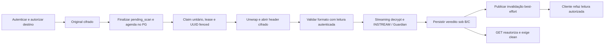

# ClamAV #1129 — Entrega D: observabilidade e eficácia isolada

## A. Snapshot Git e escopo

Execução local em 2026-11-12; issue coordenadora #1129 permanece aberta.
Worktree `/home/alvaroneto/Projects/nchat-clamav-observability`, branch
`feature/files-1129-clamav-observability`. Estado inicial limpo.
HEAD = merge-base com `origin/develop` = develop remoto confirmado por
`git ls-remote`: **`5a040225c2d57430711306855acb1870615139d7`**, merge da
[Entrega C #1168](https://github.com/nicrepository/nchat/pull/1168).
Nenhum commit, push, PR, merge, deploy ou alteração de política operacional.
Os dois untracked preexistentes no checkout original não foram tocados.

Nove módulos: `libs/go/platform`, `services/{admin-service,auth-service,
chat-service,document-converter,file-service,media-service,notification-service,
search-service}`. Todos declaram Go **1.26.11**; `go.work`, toolchain e `go version`
também 1.26.11. Prometheus client 1.22.0, pgx 5.9.2, OTel 1.45.0;
nenhuma dependência, schema, migration ou limite de operação alterado.

Inventário inicial comunicado antes da primeira edição: contratos existentes,
consumidores de `ScanObserver`, fila C, políticas B/C, testes, coleta Compose,
provider Grafana, ausência de regras antimalware e ausência de contexto Kubernetes.
Foram consultados os contratos de contribuição/segurança/PR, issue e PR remotas,
API, baseline A, arquitetura/remediação B, arquitetura/runbook/evidências C,
migrations e suítes relacionadas. O inventário final exato está em
[clamav-1129-delivery-d.sha256](clamav-1129-delivery-d.sha256); inclui este
relatório e todos os arquivos alterados, exceto o próprio manifesto.

## B. Arquitetura observada



PostgreSQL é a autoridade. `pending_scan` só termina por resultado autorizado;
falhas conservam quarentena/retry. Scan não segura lock durante I/O. Persistência
verifica workspace, token, estado e lease; rejeição conserva o fence de preview.
Somente depois do retorno confirmado pode haver evento. O evento não autoriza
bytes; cada GET volta ao gate e à autorização atuais.

A migração C nasce em preparação: NC006 mantém N+1 em standby, sem fallback.
B exige decisão de idade, Guardian, evidência e política DB coerentes.
**Código integrado não comprova ativação.** O overlay operacional não foi
alterado; candidatos B continuam separados. SEC-B-002 permanece bloqueante de
rollout: fencing não autentica um recibo fabricado por autoridade comprometida.

## C. Inventário de métricas

As dez famílias existentes foram reutilizadas. Sem labels de usuário, anexo,
workspace, nome, caminho, conteúdo, erro livre ou geração. Labels de target
`job`, `instance`, `service`, `component`, `port` são os do scrape oficial.

| Família existente                        | Tipo / proveniência / semântica preservada                                                                                                                           |
| ---------------------------------------- | -------------------------------------------------------------------------------------------------------------------------------------------------------------------- |
| `nchat_file_malware_scans_total{result}` | Counter local; resultados, inclusive resultados de scheduling. Não somar todos como denominador de tentativas. Os dez resultados fechados começam em zero conhecido. |
| `nchat_file_malware_scan_queue_depth`    | Gauge global de pendentes, inclusive leased/backoff; agora exige snapshot válido para interpretação.                                                                 |
| `..._scan_eligible`, `..._scan_leased`   | Gauges globais do mesmo SELECT; elegibilidade respeita chaves, agenda e ausência/expiração de lease.                                                                 |
| `..._scan_capacity`, `..._scan_active`   | Gauges locais de slots configurados/ocupados; podem ser somados entre réplicas.                                                                                      |
| `..._scan_claims_total`                  | Counter local de claims admitidos à execução; denominador para taxa de falha.                                                                                        |
| `..._scan_duration_seconds`              | Histogram local de tentativa, incluindo persistência e publicação; buckets `.01,.1,1,5,10,30,60,300,600`, inalterados.                                               |
| `..._scan_wait_seconds`                  | Histogram de idade na execução desde `uploaded_at`; buckets `1,5,10,30,60,300,3600,86400`, inalterados. O fallback incorreto para `created_at` foi removido.         |
| `..._scan_backoff_seconds{reason}`       | Histogram local de delay realmente persistido; buckets `10,20,40,80,160,320,640,1320,2640`, inalterados.                                                             |

**Espera não é tempo puro de fila:** em retries inclui execução anterior,
persistência e backoff. Não existe histórico de elegibilidade/claim por tentativa
que permita subtrair esses tempos com precisão. Desconhecido/futuro é omitido,
nunca substituído por criação. A distribuição da primeira espera, separada de
retries, continua indisponível; não criar uma segunda medição do mesmo intervalo.
Ao comparar versões, aguardar a saída das réplicas antigas e uma janela completa
de rate após o rollout: amostras históricas podem ter a semântica antiga.

Treze novas famílias, todas com prefixo `nchat_file_malware_scan_`:

| Sufixo                                 | Tipo / labels                   | Origem e significado                                                                                                               |
| -------------------------------------- | ------------------------------- | ---------------------------------------------------------------------------------------------------------------------------------- |
| `required`                             | Gauge local, nenhum             | Upload habilitado e aprovação AV requerida pela configuração deste processo. Não prova scanner saudável.                           |
| `queue_snapshot_success`               | Gauge local, nenhum             | Última coleta bem-sucedida; zero também significa nunca coletado.                                                                  |
| `queue_snapshot_timestamp_seconds`     | Gauge local, nenhum             | Timestamp PostgreSQL do último snapshot global confirmado; inicia em zero.                                                         |
| `queue_snapshot_errors_total`          | Counter local, nenhum           | Erro, timeout, orçamento excedido ou idade inválida; não exporta causa livre.                                                      |
| `queue_policy_enabled`                 | Gauge global, nenhum            | Política C na última coleta válida; não observa/ativa B.                                                                           |
| `oldest_pending_age_seconds`           | Gauge global, nenhum            | Idade máxima com finalização conhecida, inclui retries/leases. Zero se não há timestamp conhecido; consultar unknown junto.        |
| `pending_over_5_seconds`               | Gauge global, nenhum            | Pendentes com uploaded_at anterior a now−5s; hipótese diagnóstica, não SLO aprovado.                                               |
| `pending_unknown_finalization`         | Gauge global, nenhum            | Timestamp ausente ou futuro; população excluída dos intervalos.                                                                    |
| `backoff`                              | Gauge global, nenhum            | Tentativa anterior, agenda futura, sem lease vivo; não conta um job ativo como retry esperando.                                    |
| `phase_duration_seconds{phase}`        | Histogram local                 | Operação tentada, inclusive erro; quatro fases fechadas abaixo.                                                                    |
| `finalized_to_verdict_seconds{result}` | Histogram local; clean/rejected | Finalização conhecida até ACK de nova transição durável. Erro/ACK ambíguo, replay, superseded e rescan sem transição não observam. |
| `failures_total{reason}`               | Counter local                   | Falha primária da tentativa; doze categorias fechadas, não o texto do erro.                                                        |
| `publications_total{result}`           | Counter local; success/error    | Chamada best-effort após commit. Sem publisher não há observação. Não é ACK de cliente.                                            |

Novos histogramas usam os mesmos buckets:
`.01,.05,.1,.25,.5,1,2,5,10,30,60,300,600,3600,86400` segundos.
Fases: `storage_open`, `format_validation`, `scanner_stream`, `persistence`.
Categorias de falha: `storage_read`, `decrypt`, `clamd_unavailable`,
`clamd_protocol`, `clamd_stream_too_large`, `timeout`, `canceled`, `database`,
`database_conflict`, `unsupported_policy`, `signature_policy_inactive`,
`signature_policy_invalid`. `ObserveScan` e backoff também recusam valores fora
dos conjuntos existentes. Resultado desconhecido não cria série.

## D. Instrumentação, consistência e custo

Abertura mede unwrap/header, não leitura integral. Validação de formato inclui
seus reads/decrypt. `scanner_stream` inclui leitura lazy, autenticação, rede,
backpressure, execução e resposta Guardian/ClamAV. Persistência mede a chamada
até resposta confirmada, incluindo lock/commit e, para rejeição, o fence.
**Não são medições puras de CPU nem etapas de storage/decrypt/daemon aditivas.**
Não se mede leitura isolada por chunk nem se altera streaming para facilitar métricas.

Finalizado→veredito usa o marcador `uploaded_at` do banco e o relógio local no
ACK; é um limite superior observado ao instante de commit, não timestamp exato
de WAL commit. Depende de relógios coerentes. Finalizado→clean é a seleção
`result="clean"`. Download autorizado ainda exige GET com autorização vigente.
A duração existente continua incluindo publicação. Falhas observacionais não
retornam clean nem mudam decisões; testes provam processamento com coleta falha.

Nova consulta é **SELECT read-only**, sem SECURITY DEFINER/grants adicionais,
sem leitura de evidência de assinaturas, e retorna somente agregados. Usa o pool
do worker, já autorizado a ler seus jobs; não é a role restrita do diagnóstico A.
Predicado coincide com o índice parcial de pending. `LIMIT 10001` fica antes da
agregação, sem ORDER BY/Sort; acima de 10.000 todos os agregados são descartados.
Orçamento de contexto **2s**, inclusive espera por conexão/lock, e refresh
compartilhado por CAS no máximo uma vez a cada 10s por processo. Nenhuma consulta
por scrape/upload/scan individual; substitui o SELECT agregado anterior.

O planner pode escolher index scan para fila esparsa ou seq scan limitado para
fila densa. Não se promete limite rígido de páginas físicas/tuplas mortas.
Em PG16/17 descartáveis, 20.001 pendentes produziram `Limit → Seq Scan`, sem Sort,
lendo 10.001 linhas; execução capturada 5,735ms/6,431ms. Isso valida forma/custo
local, não o plano de produção. Primeira versão com ordenação foi rejeitada pelo
ensaio e corrigida; não foi alterado o planner para fazer o teste passar.

Erro conserva o último valor e publica success=0; nunca publica zeros de falha.
Sem coleta, timestamp=0. Regras só usam snapshots com success=1, idade <60s e
sem timestamp mais de 5s no futuro. Slots ocupados por scans longos e cooldown
podem atrasar refresh: não existe coletor paralelo de fila. Falha/limite demanda
triagem e dimensionamento, não aumento automático de orçamento. A coleta é
atômica no banco; o scrape de gauges não é uma transação entre réplicas.

## E. Dashboard e validação

`infra/observability/grafana/dashboards/nchat-file-antimalware.json`, UID
`nchat-file-antimalware`, usa o provider NChat e datasource `prometheus` existentes.
Coleta local oficial: `nchat-go-services`, file-service `host.docker.internal:8083`,
`/metrics`, intervalo 15s. Não há ServiceMonitor/scrape Kubernetes criado.

Seções: saúde/coleta e assinaturas candidatas; fila; percentis; throughput e
publicação; slots/saturação. Fila usa **max de snapshots globais recentes**.
Slots usam sum de gauges locais; counters usam sum(rate). Percentis usam
`histogram_quantile(q, sum by(le[,phase/reason]) (rate(..._bucket[5m])))`.
Sem soma de quantis e sem `or vector(0)` para fabricar saúde.
Contadores terminais começam em zero conhecido, mas ausência de target não vira zero.

Todos os painéis exibem ausência como `No data / unknown`. Assinaturas normalmente
não têm séries, porque D não liga B/scrape. CPU/RSS/throttling ClamAV não foram
inventados: falta exporter/telemetria de infraestrutura na stack local.
Provider, mount Compose, nomes/tipos/referências e queries são verificados pelo
gate existente `make grafana-dashboard-check`, owner `Infra / Config`.
Não há screenshot operacional nem alegação de Grafana rodando em cluster.

## F. Alertas e resposta operacional

O mesmo Prometheus Compose carrega `rules/file-antimalware.yml` por volume
read-only. Dez recording rules e doze alertas; nenhum Alertmanager/receiver novo.
Severidade warning, componente fixo e annotations summary/description/impact/
runbook_url em todos. `for` evita ruído de startup/scrape. Não há labels por anexo.

| Alerta                               | Condição / for / resposta                                                                                                   |
| ------------------------------------ | --------------------------------------------------------------------------------------------------------------------------- |
| FileServiceMetricsUnavailable        | Target down ou ausente, 5m; recuperar coleta/serviço, estado desconhecido.                                                  |
| FileMalwareTelemetryMissing          | Target up sem required, 10m; conferir métricas habilitadas e versão, inclusive opt-out de instrumentação.                   |
| FileMalwareWorkerUnavailable         | required=1 e capacity=0, 5m; conferir configuração/Guardian; nunca desligar required.                                       |
| FileMalwareQueueTelemetryStale       | required sem snapshot fresco, 5m; PG, orçamento/volume, scans longos, clocks; não tratar como vazio.                        |
| FileMalwareQueueStandbyWithBacklog   | C em preparação e backlog, 10m; verificar workers N e plano aprovado. Não autoriza cutover.                                 |
| FileMalwareEligibleWithoutProcessing | eligible>0, C ativa, claims rate=0, 5m; investigar drain/claim/cooldown.                                                    |
| FileMalwareBacklogGrowing            | delta de backlog positivo em 10m e conclusões=0, for 10m; comparar leases/retries/capacidade. Não detectar por healthcheck. |
| FileMalwarePendingTooOld             | Idade conhecida >300s, 5m; guard diagnóstico de triagem, não SLO de produto.                                                |
| FileMalwareRetryRateHigh             | >20% retry/too_large/policy_blocked por claims, >=20 admissions/10m, for 10m; investigar categoria.                         |
| FileMalwareSlotsSaturated            | active/capacity>=90% e eligible>0, 10m; medir recursos antes de mudar concorrência.                                         |
| FileMalwareUnknownFinalization       | Timestamps ausentes/futuros, 10m; corrigir causa/clock em procedimento separado, sem inventar datas.                        |
| FileMalwareScannerUnavailable        | Falha de transporte observada, fila pendente e zero conclusões, 2m; checar daemon/Guardian. PING não prova eficácia.        |

Alertas de trabalho exigem required; filas vazias não acionam os de backlog,
idade/saturação/stall. Alertas de telemetria continuam sinalizando desconhecido
mesmo sem tráfego. Thresholds de 300s/20%/90% são guardas diagnósticos explícitos,
sujeitos a revisão operacional; não são garantias medidas nem tuning de scan.
O detector de crescimento é conservador: throughput não zero porém insuficiente
aparece no painel/backlog/idade; não se afirma detecção de toda sobrecarga.

`file-antimalware-candidates.yml` fica **fora de rule_files**. Candidatos:
idade >= max_age configurado, readiness de política inválida, publicação
verificada atrasada (>80% da própria max_age), target Guardian ausente e p95
ACK>5s com >=100 amostras/15m (for 10m). Este último inclui todos os tamanhos e
retries, portanto não é SLO nominal benigno. Nenhuma idade arbitrária habilitada.

B já exporta idade autenticada de daily, versão numérica, max-age, último update,
loaded time, engine de allowlist e signatures_ready. Foram reutilizados sem
bypass ou acesso privilegiado. Não há RELOAD no modelo B: trocar geração drena
e reinicia. Erros de updater/ativação exigem status dos Jobs/restarts e coleta
aprovada; não se inventaram counters impossíveis de persistir a partir de um
processo que nem iniciou. Esses sinais continuam pendentes operacionalmente.

## G. Testes de eficácia e regressões reutilizadas

Novo runner `scripts/testing/clamav-efficacy-isolated.sh`, também invocado no job
segregado de fixtures de cobertura existente. Containers próprios, network=none,
sem portas publicadas, UID100 no consumidor, rootfs read-only, cap-drop ALL,
no-new-privileges, tmpfs e recursos limitados. PG16/17 com migrations completas,
roles migrator/runtime distintas, grants oficiais e políticas B/C **só na fixture**.
Não aceita DSN/credencial do host. Cleanup remove apenas recursos que criou.

`http/scan_efficacy_integration_test.go` usa engine **ClamAV 1.4.6 real**, CVD
official da imagem fixada já usada pelo projeto, Guardian verificado, criptografia
real, autorização SQL, claim SQL, persistência fenced B/C e router HTTP reais.
Storage é fixture de ciphertext em memória; JWT parsing é substituído por
principal sintético, mantendo sessão SQL real. Não é teste SeaweedFS/browser E2E.

Benigno e EICAR oficial sintético nos três destinos: canal, direct DM e group DM.
Cada caso comprova pending_scan, ciphertext, gate antes do veredito; benigno
clean/download byte a byte/SHA-256; EICAR rejected, clean counter zero e gates
content/Range/preview/manifest/página/MP3 bloqueados sem abrir storage.
Há recusa de metadata de sessão válida de outro workspace, verificação de commit
antes do evento e GET correto após falha intencional da publicação.
**PASS em PG16 e PG17**, seis casos por versão; não é mock FOUND como prova do engine.

Cobertura existente reutilizada, sem duplicar a suíte C:

| Propriedade                                                                 | Evidência executada                                                                                                                                         |
| --------------------------------------------------------------------------- | ----------------------------------------------------------------------------------------------------------------------------------------------------------- |
| Offline, timeout, conexão interrompida, protocolo truncado/inválido, limite | `scanner/clamd_test.go`, `guarded*_test.go`; unit/race; estados nunca aprovados por resposta parcial.                                                       |
| Storage, decrypt/ciphertext, EOF/tamanho, formato/MIME e política futura    | `service/malware_scan_service_test.go`, `scan_policy` e suítes de formato/crypto; unit/race.                                                                |
| Falha DB, ACK ambíguo, token antigo/lease expirado/concorrência/restart     | `storage/scan_queue_postgres_test.go`, `scan_queue_remediation_postgres_test.go`, PG16/17; nenhum evento/veredito por autoridade antiga.                    |
| Cancelamento/shutdown/drain/recuperação/retry                               | `service/scan_retry_test.go`, `worker/scan_worker_test.go`, unit/race; sem segunda implementação de scheduler.                                              |
| Assinatura inválida/expirada/clock rollback/carga/atualização               | Runner B real `clamav-signatures-isolated.sh`; `test_clamav_signature_policy.py` 16 casos por PG16/17; `signatureguard`/`signatures` negativos.             |
| GET/Range/preview/páginas e autorização após clean                          | `http/attachment_scan_gate_test.go`, suítes de áudio/custo; nova cadeia real integrada.                                                                     |
| Perda realtime/reconnect e rechecagem de permissão                          | Nova perda de publish + GET; suíte Valkey `TestSyncRecoveryValkey_` no gate de integração. Entrega/render de attachment.status no navegador não foi medida. |

Testes novos de observabilidade verificam pares start/finish, fases executadas uma
vez, durações não negativas, nenhum commit falso em erro/replay/rescan, publisher
falho sem desfazer commit, coleta falha sem impedir scan e refresh limitado.
Registry verifica nomes/tipos/buckets, duas réplicas independentes, oito workers
concorrentes, labels fechados, nenhum ID/texto livre e modo disabled/nil.
App testa registro único com/sem uploads. PG testa vazio, elegível/lease/backoff,
idade/unknown, concorrência com claim e recusa de snapshot >10.000.

## H. Segurança e fronteiras

Fail-closed, stream completo/EOF autenticado, AlertExceedsMax, formato, tamanho,
originais, gates HTTP, autorização, policy B, leases/fencing, cancelamento e
shutdown preservados. Nenhum estado externo novo, fallback de scanner, escrita
privilegiada, plaintext persistido, egress operacional ou endpoint de aprovação.
Métodos novos de métricas só atualizam registries; não participam da decisão.

Autoavaliação técnica aplicando `security-guidance` e `security-review`: entradas
novas são enums internos e agregados PG; SQL constante/parametrizado, sem chamada
administrativa; métricas sem metadados pessoais. Dois checks Semgrep locais
(labels de IDs e SQL formatado), quatro arquivos runtime: zero achados, escopo
limitado. Gitleaks do delta e scanners oficiais constam abaixo; histórico completo não foi rescaneado. Não há aprovação
independente nem afirmação de ausência de vulnerabilidades.

SEC-B-002 e os bloqueios de imagem/infra/política documentados na B permanecem;
PASS de teste sintético não os resolve. O digest selecionado não foi promovido
nem rescaneado como imagem nesta execução; Trivy FS/Config não são Trivy Image.

## I. Benchmark e SLOs

`kubectl config get-contexts -o name`: lista vazia. **BLOCKED** baseline read-only
nchat-dev, drift/estado B/C, comparação operacional antes/depois, recursos e SLOs.
Não houve conexão Kubernetes, Secrets, benchmark compartilhado ou dado de usuário.

Reprodução exclusivamente isolada:

```bash
bash scripts/testing/clamav-efficacy-isolated.sh
NCHAT_D_BENCHMARK=true bash scripts/testing/clamav-efficacy-isolated.sh
```

[Resultados reais sanitizados e metodologia](clamav-1129-benchmark.json): textos
fixos de 1KiB/1MiB/10MiB, SHA-256 registrado, dez amostras por tamanho/PG, um warm-up
por tamanho, concorrência/réplica=1, falhas abortam sem descartar erros. Percentis
nearest-rank. P95/P99 com N=10 são o máximo: baixa significância estatística.
Go/Guardian/clamd compartilham container de 2CPU/3GiB; PG 1CPU/512MiB; host Ryzen
7 5825U, outras validações concorrentes. Base histórica daily28085 (2026-08-07),
idade permissiva **só de fixture isolada**, não configuração operacional.

Exemplo 10MiB, segundos p50/p95/p99:

| Intervalo                    | PG16                           | PG17                           |
| ---------------------------- | ------------------------------ | ------------------------------ |
| Idade na execução            | 0,001557 / 0,002392 / 0,002392 | 0,001859 / 0,002527 / 0,002527 |
| Tentativa completa           | 0,067432 / 0,072630 / 0,072630 | 0,062727 / 0,068157 / 0,068157 |
| Finalizado→ACK clean         | 0,069094 / 0,074512 / 0,074512 | 0,064126 / 0,070588 / 0,070588 |
| Finalizado→GET completo/hash | 0,093457 / 0,100901 / 0,100901 | 0,087913 / 0,094098 / 0,094098 |

Não há claim de melhoria quantitativa: **não existe baseline comparável**.
Esse ensaio chama ProcessDue diretamente, exclui o poll ocioso de 10s, usa storage
em memória, um formato e sem bursts. Não homologa throughput nominal, CPU/RSS,
saturação clamd, storage/rede, recuperação de outage ou réplicas distribuídas.
Os limites de inspeção/conteúdo não foram reduzidos para obter números. O worker C
mantém poll ocioso de 10s: um upload que chega nessa janela pode esperar quase
10s mesmo sem backlog anterior. D não altera o scheduler; o ensaio direto não
pode ser usado para esconder essa limitação frente à hipótese de espera <=1s.

Fila p95<=1s sem backlog e finalizado→download p95<=5s para benignos <=10MiB
continuam **hipóteses NÃO VALIDADAS**. Zero liberações indevidas no EICAR conhecido
foi comprovado só no corpus/local executado; não significa cobertura universal.

Contrato independente necessário para verdict→client_visible: protocolo/trace
sintético que correlacione transição durável, refetch autorizado e ACK de render,
com relógios/versões e perdas/reconnect explícitos. Nenhum file/user ID em labels;
correlação efêmera de teste, amostragem e retenção precisam de revisão própria.
Publisher success e UpdatedAt do evento não substituem esse ACK.

## J. Validações

PASS significa comando executado; fixtures opt-in separadas não são cobertas pelo
simples sucesso de unitários que as pulam. Evidências brutas locais ficam em
`/tmp/nchat-d-*.log` (não versionadas); este relatório/JSON/manifesto são a síntese
auditável sem conteúdo de anexos/credenciais operacionais.
[Registro de comandos e hashes das execuções](clamav-1129-validation.json).

| Comando / escopo                                                                                             | Resultado                                                                                                                                   |
| ------------------------------------------------------------------------------------------------------------ | ------------------------------------------------------------------------------------------------------------------------------------------- |
| `make test-go`                                                                                               | PASS nove módulos; opt-in executados separadamente.                                                                                         |
| `make ci-static-go`                                                                                          | PASS gofmt/vet/golangci-lint.                                                                                                               |
| `bash scripts/ci/go-test.sh -race`                                                                           | PASS nove módulos.                                                                                                                          |
| `make test-integration-go`                                                                                   | PASS suites oficiais em PG16/Valkey próprios, network=none/Unix sockets; sem bancos compartilhados.                                         |
| `make go-coverage-check` com fixtures oficiais PG/B/C                                                        | PASS todos >=90%; threshold preservado.                                                                                                     |
| `make ci-static-repository`                                                                                  | PASS; gate oficial executado.                                                                                                               |
| `make ci-infra-config`, `make ci-infra-kubernetes`, `make ci-infra-migrations`, `make ci-architecture-check` | PASS; renders/checks estáticos, nenhum apply.                                                                                               |
| `make grafana-dashboard-check` / promtool 2.54.1                                                             | PASS config, 22 regras ativas, cinco candidatas, fixtures de alerta/percentis e todas as queries do dashboard sem séries.                   |
| `python3 scripts/security/test_govulncheck_gate.py`                                                          | PASS.                                                                                                                                       |
| `bash scripts/security/govulncheck.sh`                                                                       | PASS após reconstruir v1.1.4 com Go1.26.11 em /tmp; binário instalado com Go1.25 falhou antes, sem scan válido. Nenhuma exceção adicionada. |
| `make security-trivy-fs`, `make security-trivy-config`                                                       | PASS, Trivy0.75.0, HIGH/CRITICAL conforme gates oficiais.                                                                                   |
| `bash scripts/testing/scan-queue-postgres.sh`                                                                | PASS PG16/17, fencing/N+1, métricas/plano limitado e perfis de cobertura.                                                                   |
| `bash scripts/testing/clamav-signatures-isolated.sh`                                                         | PASS engine/base oficiais reais, negativos B e cadeia de persistência. Segunda imagem opcional não executada nesta sessão.                  |
| `CLAMAV_POLICY_TEST_POSTGRES={16,17} python3 scripts/testing/test_clamav_signature_policy.py -v`             | PASS 16 casos em cada versão.                                                                                                               |
| `bash scripts/testing/clamav-efficacy-isolated.sh`                                                           | PASS PG16/17, seis cenários/contextos por versão; benchmark opcional também PASS.                                                           |
| Semgrep local, duas regras/quatro arquivos runtime                                                           | PASS zero achados nesse escopo, não auditoria independente.                                                                                 |
| Gitleaks delta / diff final                                                                                  | PASS, cópia privada do delta com redaction e git diff --check.                                                                              |
| Cluster, baseline A, SLO nominal, UI/render ACK, Sonar/CI remoto                                             | BLOCKED ou NOT RUN; não declarados aprovados.                                                                                               |

Cobertura final: platform94,4%; admin91,3%; auth90,8%; chat91,0%; converter92,7%;
**file90,8%**; media92,4%; notification95,9%; search98,1%.

Falhas de preparação corrigidas e reexecutadas: prontidão TCP final PG em vez do
socket do init, glob sem migrations opcionais, rotas reais document-preview,
permissão do arquivo temporário de queries para promtool não-root, tmpfs insuficiente
na fixture geral, URI de socket percent-encoded exigida pelo helper de cleanup
de meetings. Nenhuma assertion, scanner, threshold ou proteção foi desabilitada.
A primeira consulta ordenada foi corrigida após EXPLAIN, conforme seção D.

## K. Riscos e pendências

- Sem contexto autorizado nchat-dev; nenhuma conclusão sobre estado efetivo B/C,
  engine/base em execução, backlog ou melhoria operacional.
- SEC-B-002, política de idade aprovada, mirror/RWX/CNI/grants/clocks/capacidade
  continuam gates independentes de rollout. Não contornados pela observabilidade.
- Snapshot >10.000 ou >2s indisponível, não aproximado. Revalidar plano/overhead
  read-only com operador antes de habilitar em ambiente compartilhado.
- Longos scans atrasam snapshot; ausência nunca representa fila vazia. Global max
  de snapshots recentes pode superestimar brevemente durante drain.
- Sem histórico imutável de claim/commit, sem primeira espera separada de retries,
  sem ACK de render/telemetria de updater ou infra. Não adicionar schema por conveniência.
- Um processo por DB/stack local é o agrupamento configurado. Se um Prometheus
  coletar vários clusters/databases, preservar env/cluster nas regras/targets antes
  do uso; não agregar globalmente bancos diferentes.
- D não modifica N/N+1 SQL. Mistura de binários antigos não emite métricas D;
  versões/ausência e janela de rate devem ser consideradas no rollout.

## L. Integração, divisão D1/D2 e rollback

**D1 integrável sem D2:** app/metrics/observer/service/storage complementares,
seus unitários e teste PG de snapshot; dashboard, regras/config Compose, checks
Grafana/observabilidade, runbook/API e documentação. Não depende do teste de
engine novo nem de ativar B/C. Não incluir migrations ou tuning.

**D2 separado conceitualmente:**
`services/file-service/internal/http/scan_efficacy_integration_test.go`,
`scripts/testing/clamav-efficacy-isolated.sh`, o passo correspondente em
`.github/workflows/ci.yml` e `docs/observability/clamav-1129-benchmark.json`.
D2 usa os instrumentos D1 para afirmar métricas, sem mudar runtime.
Relatório/manifesto podem ser divididos ao preparar PRs; nenhuma PR foi criada.

Possíveis conflitos: wiring de métricas no App, mesma função de scan instrumentada
pela C, dashboard/checks compartilhados. Reconciliar sem tocar fencing/policy.
Rollout futuro exige revisão humana e processo existente. Conferir flags, versão,
labels, overhead PG e janela sem réplicas antigas; observar fila/retries antes de
qualquer aumento de concorrência. Regras locais não habilitam coleta Kubernetes.

Rollback D1: reverter instrumentação/config/dashboard e regras por entrega normal;
nenhum dado/schema precisa de reversão. **Não** usar rollback de D para desfazer
cutover C ou política B: seus procedimentos e bloqueios continuam válidos.
Rollback D2 remove apenas teste/runner/passo CI/artefato, sem efeito operacional.
Merge/review não autoriza deploy, assinatura, cutover ou alteração de nchat-prod.

## M. Parecer final

**IMPLEMENTATION READY FOR REVIEW — escopo local D1 e D2 de componentes.**
Observabilidade, testes e evidência sintética implementados; nenhuma aprovação
independente autoatribuída. A issue #1129 não está concluída operacionalmente.
Ativação B/C, baseline comparativo, carga nominal, recursos/throughput real e
visibilidade/renderização do frontend permanecem pendentes, com contratos e
limites explícitos. SLOs operacionais não validados; rollout continua bloqueado
pelos gates próprios de B/C.
